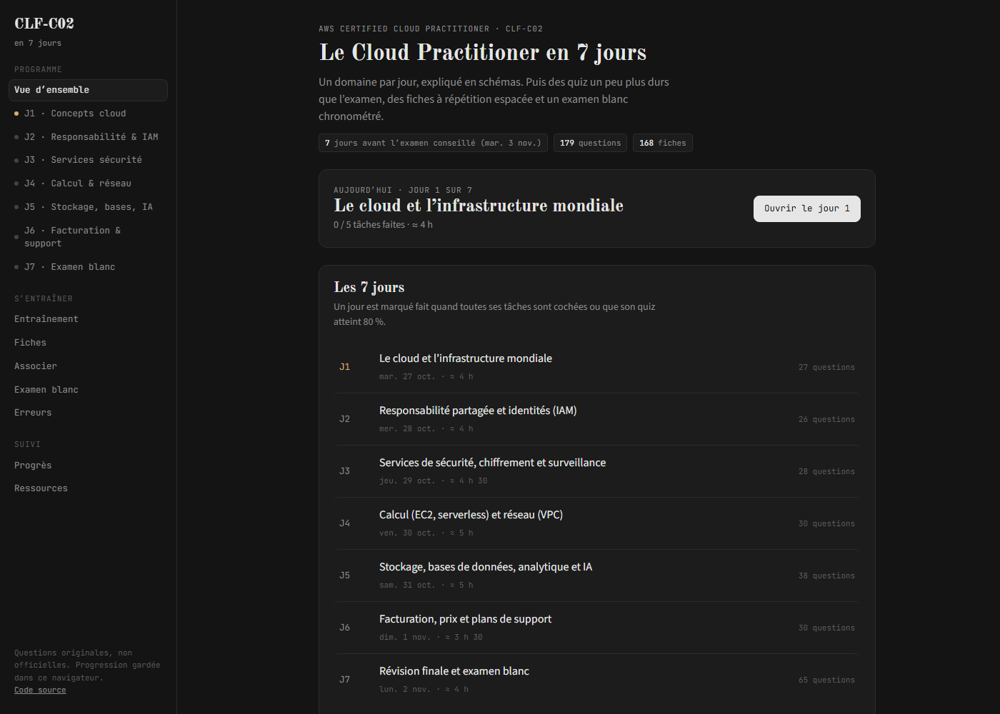
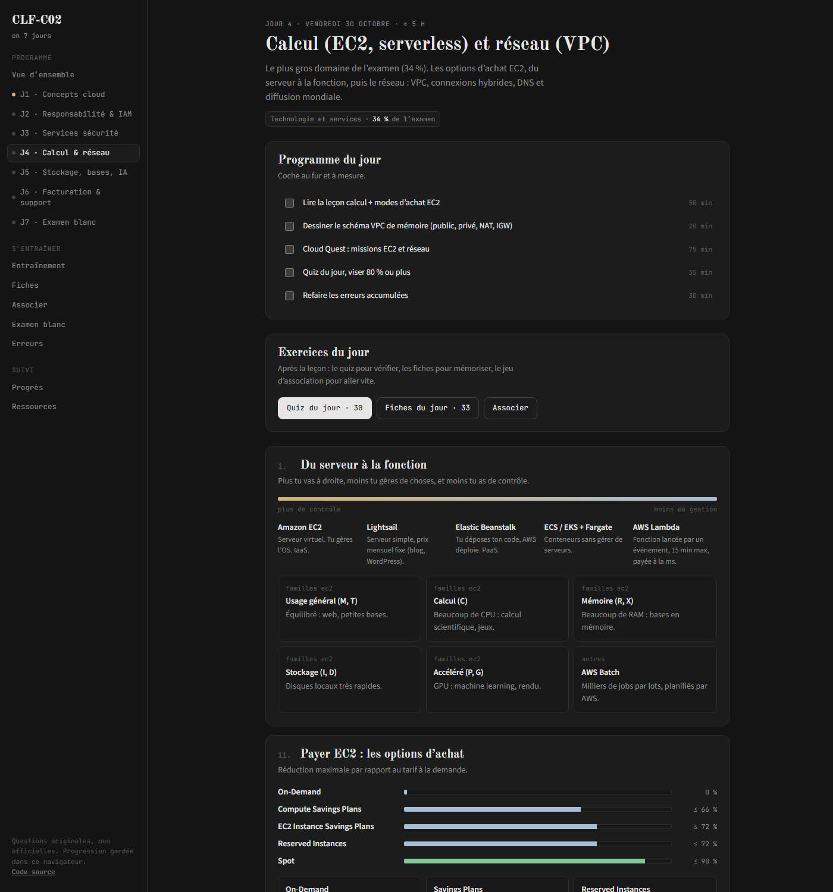

<div align="center">

# CLF-C02 en 7 jours

**Préparer l'AWS Certified Cloud Practitioner en une semaine, en français et en schémas.**

[Ouvrir le site](https://forgedemir.github.io/aws-clf-c02-7-jours/) · [Signaler une erreur](https://github.com/ForgedEmir/aws-clf-c02-7-jours/issues)


</div>



## I. L'idée

Un domaine de l'examen par jour, expliqué avec des schémas plutôt qu'avec des pavés de texte. Après chaque leçon, des exercices un peu plus difficiles que l'examen réel, pour que le jour J paraisse simple. Le septième jour, un examen blanc chronométré dans les conditions réelles.

Le site est entièrement statique : pas de compte, pas de serveur, pas de clé d'API. Il marche dans n'importe quel navigateur, s'installe comme une application et fonctionne hors ligne après la première visite.

## II. Le programme

| Jour | Sujet | Part de l'examen |
|---|---|---|
| J1 | Concepts du cloud, infrastructure mondiale, Well-Architected, CAF, 7 R | 24 % |
| J2 | Responsabilité partagée, IAM, Organizations | 30 % (J2 et J3) |
| J3 | Services de sécurité, chiffrement, CloudTrail, Config, CloudWatch | |
| J4 | EC2 et options d'achat, serverless, réseau VPC | 34 % (J4 et J5) |
| J5 | Stockage, bases de données, analytique, IA, intégration | |
| J6 | Facturation, outils de coûts, plans de support | 12 % |
| J7 | Paires qui piègent, tactique du jour J, examens blancs | tout |

Chaque jour contient une liste de tâches à cocher, une leçon visuelle (schémas d'architecture, tableaux de responsabilité, barres de prix, temps de réponse du support à l'échelle), les pièges classiques et les exercices du jour.



## III. Les exercices

- **Quiz du jour** : 26 à 38 questions par jour, correction et explication après chaque réponse.
- **Entraînement** : une série à la carte, par domaine, sur les questions jamais vues ou sur tes points faibles.
- **Fiches** : 168 services et concepts en répétition espacée (boîtes de Leitner). Une fiche ratée revient le jour même, une fiche connue revient de plus en plus tard.
- **Associer** : relie six services à leur rôle, le plus vite possible.
- **Examen blanc** : 65 questions tirées selon la répartition officielle (24 / 30 / 34 / 12 %), 90 minutes, retour en arrière, questions marquées, grille de navigation, corrigé et score par domaine à la fin. Le chrono continue si tu quittes la page.
- **Mes erreurs** : toute question ratée, quel que soit l'exercice, arrive ici jusqu'à ce que tu y répondes juste.

Raccourcis clavier : `1` à `5` pour répondre, `Entrée` pour valider, `←` `→` et `F` dans l'examen blanc, `Espace` pour retourner une fiche.

## IV. La progression

Tout reste dans ton navigateur (`localStorage`) : tâches cochées, scores, erreurs, boîtes des fiches, historique des examens blancs. Le jour 1 est le jour de ta première visite, et tu peux le déplacer dans Ressources (aujourd'hui, demain ou une date au choix). La page Progrès affiche ta réussite par domaine et permet d'exporter ou d'importer un fichier de sauvegarde pour changer d'appareil.

## V. Les questions

Toutes les questions sont **originales**, écrites à partir du [guide officiel de l'examen CLF-C02](https://docs.aws.amazon.com/aws-certification/latest/cloud-practitioner-02/cloud-practitioner-02.html). Aucune ne vient de « dumps » : publier ou utiliser de vraies questions d'examen va contre l'accord de certification AWS.

Ce projet n'est ni affilié ni approuvé par Amazon Web Services. AWS et les noms de services sont des marques d'Amazon.com, Inc.

## VI. Lancer en local

Aucune installation n'est nécessaire : ouvre `index.html` dans un navigateur. Pour tester le mode hors ligne, sers le dossier en HTTP :

```bash
npx serve .
```

Avant de proposer une modification de la banque de questions :

```bash
node scripts/check-data.mjs
```

## VII. Structure

```
index.html              page unique
assets/app.js           moteur : navigation, quiz, examen blanc, fiches, progression
assets/style.css        thème sombre
data/days.js            leçons des 7 jours, schémas SVG inclus
data/questions.js       banque de questions
data/cards.js           fiches
sw.js                   cache hors ligne
scripts/check-data.mjs  vérification de la banque (lancée aussi par GitHub Actions)
```

Pour ajouter une question, ajoute un objet dans `data/questions.js` : `id` unique, `d` (jour 1 à 6), `q` (énoncé), `o` (3 à 5 options), `a` (index des bonnes réponses), `x` (explication). Pense à changer `VERSION` dans `sw.js` pour que les appareils déjà installés récupèrent la mise à jour.

## VIII. Ressources

- [AWS Cloud Quest : Cloud Practitioner](https://skillbuilder.aws/learn/FU5WCYVGKY/aws-cloud-quest-cloud-practitioner/MKTEWB6FBP), le jeu de rôle gratuit d'AWS
- [Official Practice Question Set CLF-C02](https://skillbuilder.aws/), 20 questions officielles gratuites
- [Synthèse CLF-C02 par j-mahapatra](https://github.com/j-mahapatra/aws-certified-cloud-practitioner-clf-c02)
- [Guide et erreurs fréquentes](https://towardsthecloud.com/blog/aws-cloud-practitioner-exam-guide)

Le thème visuel s'inspire de [LearnHarness](https://github.com/amosblomqvist/learnharness).

## Licence

[MIT](LICENSE)
